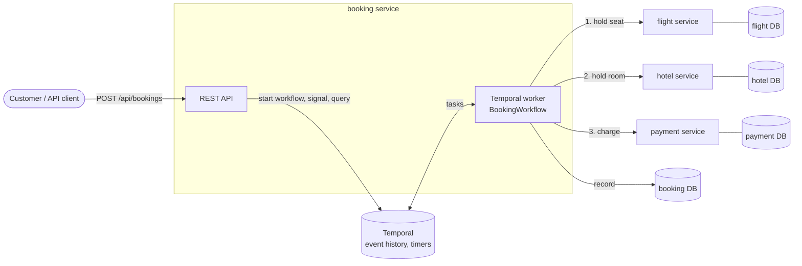

# TripSaga

TripSaga is the booking backend of a travel site, written in Java with Spring Boot, PostgreSQL and Temporal. One booking holds a flight seat, holds a hotel room and charges the card. Those three things live in three services with three separate databases, so no database transaction can cover them. The booking is a **saga**: every step commits on its own, and when a later step fails the earlier ones are undone by **compensations**, newest first. The saga runs as a Temporal workflow, so it survives crashes and restarts.

I built it to practise the questions every distributed transaction raises: what if the third step fails, what if a request times out and we do not know whether it happened, what if the process dies halfway, and what if the undo itself fails.

[](https://github.com/hmzckd/tripsaga/actions/workflows/ci.yml)

## What it includes

- Four Spring Boot services in one Maven build: `booking` (public API and saga orchestrator), `flight`, `hotel` and `payment`, each with its own PostgreSQL database and user
- An orchestrated saga as a Temporal workflow: hold seat, hold room, charge (the pivot), confirm seat and room
- Compensations in reverse order when a step is rejected: cancel the room, cancel the seat, refund or void the payment
- `Idempotency-Key` on every write to a participant, so Temporal can retry any call without holding two seats or charging twice
- Compensation by idempotency key with **tombstones**, so a request whose answer was lost, or that arrives after its own cancel, can never leak a seat, a room or money
- Retry policies per step: business rejections (`4xx`) are final, technical failures (`5xx`, timeouts) are retried 4 times on the way forward and forever on the way back
- Customer cancel as a Temporal **signal**, accepted until the payment is captured
- Payments that wait for the bank (`tok_pending`), checked on a durable timer and voided after 15 minutes
- `NEEDS_ATTENTION` for the rare case where an undo or a confirm is rejected and a person has to decide
- Safe workflow changes behind `Workflow.getVersion`, proven by replaying a stored event history in the build
- Demo-only fault injection in the participants: slow answers, failed requests and lost answers
- Tests with Temporal's time-skipping test environment, WireMock and PostgreSQL in Testcontainers

## How it fits together



`POST /api/bookings` starts the workflow `booking-<id>` and answers `202 Accepted` at once. The worker in the same service runs the saga. Every activity is one HTTP call to a participant with a stable idempotency key such as `<id>-flight-hold`. Temporal stores each step in the workflow's event history; after a crash the worker replays that history and continues from where it stopped, without calling the finished steps again.

```text
hold seat ──► hold room ──► charge ──► confirm seat ──► confirm room ──► CONFIRMED
    │             │            │ (pivot: from here on the saga only moves forward)
    ▼             ▼            ▼
 rejected?    rejected?    declined / timed out / customer cancelled
    └─────────────┴────────────┴──► refund payment ─► cancel room ─► cancel seat ─► CANCELLED
```

## Stack

| Area | Technology |
| --- | --- |
| Services | Java 21, Spring Boot 4.1 (Web MVC, Actuator, Validation), virtual threads |
| Orchestration | Temporal Java SDK 1.41 (plain SDK, no starter), Temporal dev server with Web UI |
| Database | PostgreSQL 17, one database and user per service, Spring JDBC (`JdbcClient`), Flyway |
| HTTP between services | Spring `RestClient` on the JDK HTTP client, 2 s connect and 5 s read timeout |
| Tests | JUnit 5, Temporal `TestWorkflowEnvironment` and `WorkflowReplayer`, WireMock, Testcontainers, Awaitility, Mockito |
| Container | One multi-stage Dockerfile for all services, JRE image, non-root user |
| CI | GitHub Actions |

## Repository layout

```text
.
├── booking/                    public API, saga workflow and Temporal worker
│   └── src/main/java/com/hmzckd/tripsaga/booking/
│       ├── api/                REST controller: book, get, cancel
│       ├── saga/               BookingWorkflow, activity interfaces, booking state
│       ├── participants/       activity implementations: HTTP clients for flight, hotel, payment
│       ├── records/            bookings table in the booking database
│       └── temporal/           Temporal client, worker and lifecycle
├── flight/                     seats: hold, confirm, cancel (by id or by idempotency key)
├── hotel/                      rooms: hold, confirm, cancel (by id or by idempotency key)
├── payment/                    charges: capture, decline, pending, complete, refund, void
├── faults/                     demo-only fault injection used by the three participants
├── docker/postgres/init.sql    one database and one user per service
├── docs/adr/                   architecture decision records
├── GLOSSARY.md                 saga and Temporal terms
├── Dockerfile
├── compose.yaml                PostgreSQL, Temporal and the four services
└── .github/workflows/ci.yml
```

## Run locally

### Requirements

- Docker Desktop
- JDK 21 or newer, to run the tests or the services without Docker

### 1. Start everything

```powershell
docker compose --profile app up -d --build
```

| Service | Address |
| --- | --- |
| Booking API | `http://localhost:8080` |
| Flight, hotel, payment | `http://localhost:8081`, `:8082`, `:8083` |
| Temporal Web UI | `http://localhost:8233` |
| Temporal gRPC | `localhost:7233` |
| PostgreSQL | `localhost:5440`, user `postgres`, password `postgres`; databases `flight`, `hotel`, `payment`, `booking` |

Seed data: flights `TK2412`, `PC2016`, `TK2850` (2 seats) and `XQ0000` (sold out); hotels `AYT-LARA`, `IZM-ALSANCAK`, `DLM-KOY` (1 room) and `BJV-DOLU` (full).

### 2. Book a trip

```powershell
$body = '{"customer":"Ayse Yilmaz","flightId":"TK2412","hotelId":"AYT-LARA","nights":3,"cardToken":"tok_ok"}'
$booking = Invoke-RestMethod -Method Post -Uri http://localhost:8080/api/bookings -ContentType "application/json" -Body $body
Invoke-RestMethod "http://localhost:8080/api/bookings/$($booking.id)"
```

The answer lists every step: two holds, the charge and two confirms. Open the Temporal UI and find the workflow `booking-<id>` to see the same steps as events.

### 3. Watch a compensation

Use the card token `tok_declined`, or the full hotel `BJV-DOLU`. The booking ends as `CANCELLED` with the reason, and its steps show the room and the seat being cancelled after the failure, newest first.

### 4. Lose an answer

The participants started by compose accept fault settings at `/admin/faults`:

```powershell
Invoke-RestMethod -Method Put -Uri http://localhost:8082/admin/faults -ContentType "application/json" -Body '{"loseNext":4}'
```

The next four writes to the hotel are done but answered with `503`. The saga retries with the same idempotency key, gives up after four attempts and cancels the room **by its key**. Check `GET http://localhost:8082/hotels`: no room is left blocked. `failNext` fails writes without doing them and `delayMs` slows them down. `DELETE /admin/faults` resets everything.

### 5. Kill the orchestrator halfway

```powershell
Invoke-RestMethod -Method Put -Uri http://localhost:8082/admin/faults -ContentType "application/json" -Body '{"delayMs":4000}'
$booking = Invoke-RestMethod -Method Post -Uri http://localhost:8080/api/bookings -ContentType "application/json" -Body $body
docker compose kill booking
docker compose start booking
Invoke-RestMethod "http://localhost:8080/api/bookings/$($booking.id)"
```

The booking service died while the room was being held. After the restart the worker replays the history, retries the room hold with the same key (the hotel answers with the hold it already made) and finishes the booking as `CONFIRMED`.

### 6. Wait for the bank, or cancel

With the card token `tok_pending` the payment service answers `202 Accepted` and the booking waits in `PAYMENT_PENDING`, checking the charge every 10 seconds for up to 15 minutes. Play the bank:

```powershell
$charge = Invoke-RestMethod "http://localhost:8083/charges/by-key/$($booking.id)-payment"
Invoke-RestMethod -Method Post -Uri "http://localhost:8083/charges/$($charge.id)/complete" -ContentType "application/json" -Body '{"outcome":"CAPTURED"}'
```

Or let the customer change their mind before the bank decides:

```powershell
Invoke-RestMethod -Method Post -Uri "http://localhost:8080/api/bookings/$($booking.id)/cancel" -ContentType "application/json" -Body '{"reason":"changed plans"}'
```

The pending charge is voided and both holds are cancelled. After the payment is captured, a cancel is answered `409 Conflict`.

### Run the services with Maven instead

```powershell
docker compose up -d
.\mvnw.cmd -pl flight spring-boot:run
.\mvnw.cmd -pl hotel spring-boot:run
.\mvnw.cmd -pl payment spring-boot:run
.\mvnw.cmd -pl booking spring-boot:run
```

Without `--profile app`, compose starts only PostgreSQL and Temporal. Each command needs its own terminal. Fault injection is off unless a participant is started with `--tripsaga.faults.enabled=true`.

| Variable | Default | Meaning |
| --- | --- | --- |
| `SPRING_DATASOURCE_URL` | `jdbc:postgresql://localhost:5440/<service>` | The service's own database |
| `TRIPSAGA_TEMPORAL_TARGET` | `localhost:7233` | Temporal frontend (booking only) |
| `TRIPSAGA_PARTICIPANTS_FLIGHT_URL` | `http://localhost:8081` | Flight service (booking only) |
| `TRIPSAGA_PARTICIPANTS_HOTEL_URL` | `http://localhost:8082` | Hotel service (booking only) |
| `TRIPSAGA_PARTICIPANTS_PAYMENT_URL` | `http://localhost:8083` | Payment service (booking only) |
| `TRIPSAGA_FAULTS_ENABLED` | `false` | Enables `/admin/faults` (participants only) |

## Checks

Docker must be running, because the tests start their own PostgreSQL containers. The workflow tests need no Temporal server; they use Temporal's in-memory test environment, which skips over timers, so the 15-minute payment timeout is tested in milliseconds.

```powershell
.\mvnw.cmd test
```

## API

| Method | Route | Purpose |
| --- | --- | --- |
| POST | `/api/bookings` | Start a booking: `customer`, `flightId`, `hotelId`, `nights` (1 to 30), `cardToken`. Answers `202` with the id |
| GET | `/api/bookings/{id}` | Status, total, failure reason and every step, including compensations |
| POST | `/api/bookings/{id}/cancel` | Cancel before the payment is captured. Answers `202`, or `409` when it is too late |

Booking statuses: `STARTED`, `FLIGHT_HELD`, `HOTEL_HELD`, `PAYMENT_PENDING`, `PAYMENT_CAPTURED`, `CONFIRMED`, `COMPENSATING`, `CANCELLED`, `NEEDS_ATTENTION`.

Participant routes used by the saga:

| Service | Route | Purpose |
| --- | --- | --- |
| flight, hotel | `POST /holds` + `Idempotency-Key` | Hold a seat or room: `201`, replay `200`, sold out `409`, key reused for another request `422` |
| flight, hotel | `POST /holds/{id}/confirm` | Confirm a hold |
| flight, hotel | `POST /holds/by-key/{key}/cancel` | Cancel the hold made with that key, or leave a tombstone if it has not arrived |
| payment | `POST /charges` + `Idempotency-Key` | Charge: captured `201`, pending `202`, declined `402` |
| payment | `GET /charges/{id}`, `GET /charges/by-key/{key}` | Read a charge |
| payment | `POST /charges/{id}/complete` | The bank's decision for a pending charge (demo) |
| payment | `POST /charges/by-key/{key}/refund` | Refund a captured charge, void a pending one, or leave a tombstone |

Errors are returned as `application/problem+json`. There is no authentication; the participant routes would only be reachable inside the cluster in a real deployment.

## Design decisions

- **Orchestration with Temporal, not choreography** ([ADR 0001](docs/adr/0001-orchestrate-the-booking-saga-with-temporal.md)). The whole flow and its compensations read top to bottom in one class, and crash recovery, retries and timers come from Temporal.
- **Every write is idempotent** ([ADR 0002](docs/adr/0002-make-every-participant-call-idempotent.md)). The key lives in a `UNIQUE` column; the insert runs first with `ON CONFLICT DO NOTHING`, so even parallel retries take stock once.
- **Payment is the pivot** ([ADR 0003](docs/adr/0003-order-the-steps-so-payment-is-the-pivot.md)). Cheap, reversible holds come first and money comes last, so a declined card never needs a refund.
- **Retry forward a few times, backward until done** ([ADR 0004](docs/adr/0004-retry-forward-steps-a-few-times-and-compensations-until-done.md)).
- **Compensate by key and leave tombstones** ([ADR 0005](docs/adr/0005-compensate-by-idempotency-key-and-leave-a-tombstone.md)). The saga registers each undo *before* it calls the step.
- **Change running workflows only behind `getVersion`** ([ADR 0006](docs/adr/0006-change-the-workflow-behind-getversion-and-prove-it-by-replay.md)), checked by `ReplayTest` against a stored history.
- Each service owns its code and its database; only the demo fault injection is shared, as a small library.
- Inventory is a simple counter per flight and hotel, without dates, because the project is about the saga, not about availability calendars.

## Roadmap

- Hold expiry in the participants, so a hold that no saga ever confirms or cancels frees itself
- A Temporal Update instead of a signal for cancel, so the caller learns synchronously whether the cancel was accepted
- OpenTelemetry traces from the API through the workflow into the participants
